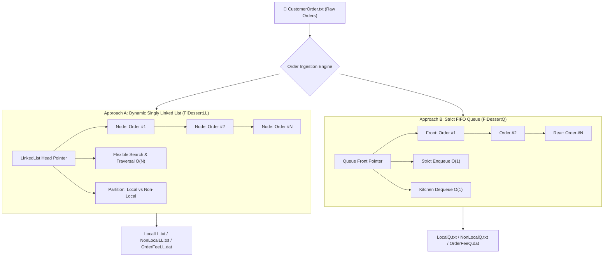

# 🍰 Seri Malaya Dessert Cafe — Data Structure Comparative Analysis (Linked List vs. Queue)

[](https://www.oracle.com/java/)
[]()
[]()
[]()
[](LICENSE)

> **Seri Malaya Dessert Cafe Management System** is a dual-implementation Java case study that investigates and evaluates the operational efficiency of **Singly Linked Lists** versus **FIFO Queues** in restaurant point-of-sale and kitchen order queuing. Designed for a traditional Malaysian dessert cafe, it handles order ingestion from raw text files, classification into domestic vs. imported confectionery, price updates, automated checkout tallying, and binary data serialization (`.dat`).

---

## 📌 Case Study Background & Academic Motivation

**Seri Malaya Dessert Cafe** is an artisanal confectionery shop serving both traditional Malaysian heritage delicacies (e.g., *Kuih Lapis, Seri Muka, Pulut Tai Tai*) and Western pastries (*Cheesecake, Tiramisu, Croissants*).

As footfall expanded, handwritten paper ticketing resulted in:
1. **Queue Inversion:** Orders being prepared out of chronological arrival order, creating customer dissatisfaction.
2. **Illegible Slips & Data Loss:** Lost or damaged order slips leading to unpaid meals and reconciliation deficits.
3. **Slow Bill Consolidation:** Mathematical errors when computing service charges and totals during peak rush periods.

To address this, two complete parallel systems were developed from scratch using fundamental data structures:
* **Linked List Implementation (`FIDessertLL.java`):** Emphasizes dynamic pointer insertion, arbitrary element traversal, and in-place node searching.
* **Queue Implementation (`FIDessertQ.java`):** Emphasizes strict **FIFO (First-In, First-Out)** sequencing, mirroring real-world kitchen preparation lines.

---

## ⚖️ Comparative Evaluation: Linked List vs. FIFO Queue



| Dimension | Singly Linked List (`FIDessertLL`) | FIFO Queue (`FIDessertQ`) | Best Suited For |
|---|---|---|---|
| **Insertion Time** | $\mathcal{O}(1)$ at head / $\mathcal{O}(n)$ at tail | $\mathcal{O}(1)$ enqueue at rear | **Queue** (ideal for continuous arrivals) |
| **Deletion Time** | $\mathcal{O}(n)$ to locate arbitrary node | $\mathcal{O}(1)$ dequeue from front | **Queue** (guarantees oldest order served first) |
| **Search by Customer ID** | $\mathcal{O}(n)$ sequential node traversal | Requires full dequeue & temporary buffer | **Linked List** (superior for customer lookups) |
| **Kitchen Workflow Alignment** | High risk of arbitrary order selection | Enforces fair First-Come, First-Served order | **Queue** (fairness guarantee) |
| **Partitioning Local / Non-Local** | Direct node relinking without data destruction | Destructive read unless auxiliary queue used | **Linked List** |

---

## 🍮 Dessert Classification & Menu Taxonomy

Items ingested into the system are dynamically validated across four categories:
1. **`Cake`** — Western and artisan layer cakes (Tiramisu, Basque Burnt Cheesecake).
2. **`Pastry`** — Flaky croissants, fruit tarts, and baked goods.
3. **`Traditional`** — Traditional Nyonya and Malay kuih-muih.
4. **`Others`** — Waffles, puddings, ice desserts (Cendol, ABC).

Each entry tracks:
* `dessertName` | `dessertID` | `category` | `origin` (Local `L` vs. Non-Local `N`) | `price` | `quantity`

---

## 📂 Project Directory Structure

```text
Seri_Malaya_Dessert_Cafe/
├── Dessert.java             # Core domain model (attributes, getters/setters, fee calculations)
├── Node.java                # Self-referential singly linked list node
├── LinkedList.java          # Custom Singly Linked List data structure operations
├── Queue.java               # Custom FIFO Queue data structure implementation
├── FIDessertLL.java         # Driver system utilizing Singly Linked List
├── FIDessertQ.java          # Driver system utilizing FIFO Queue
├── CustomerOrder.txt        # Initial raw transaction seed data
├── LocalLL.txt / LocalQ.txt # Local confectionery partition outputs
├── NonLocalLL.txt / NonLocalQ.txt # Imported dessert partition outputs
├── OrderFeeLL.dat / OrderFeeQ.dat # Binary serialized transaction files
├── PurchasedDataLL.txt / PurchasedDataQ.txt # Customer sales invoice outputs
├── README.md                # System documentation & comparative study analysis
└── .gitignore               # Excludes compiled bytecode (.class)
```

---

## 🛠️ Compilation & Execution Guide

### 1. Prerequisites
* **Java Development Kit (JDK):** Version 8, 11, 17, or 21 (`javac -version`).

### 2. Clone the Repository
```bash
git clone https://github.com/akhmal02/Seri_Malaya_Dessert_Cafe.git
cd Seri_Malaya_Dessert_Cafe
```

### 3. Compile the Java Source Files
```bash
javac Node.java LinkedList.java Queue.java Dessert.java FIDessertLL.java FIDessertQ.java
```

### 4. Run the Linked List System
```bash
java FIDessertLL
```

### 5. Run the Queue System
```bash
java FIDessertQ
```

Both programs automatically read `CustomerOrder.txt`, process transactions, and export itemized logs to their respective `.txt` and serialized `.dat` files.

---

## 👨‍💻 Authors & Academic Attribution
* **Developer:** Muhammad Akhmal bin Mohamad Hussin ([@akhmal02](https://github.com/akhmal02))
* **Group:** CS1103E
* **Institution:** Universiti Teknologi MARA (UiTM)
* **Faculty:** College of Computing, Informatics and Mathematics
* **Course:** Data Structures & Algorithm Analysis (CSC248 / CSC508)
